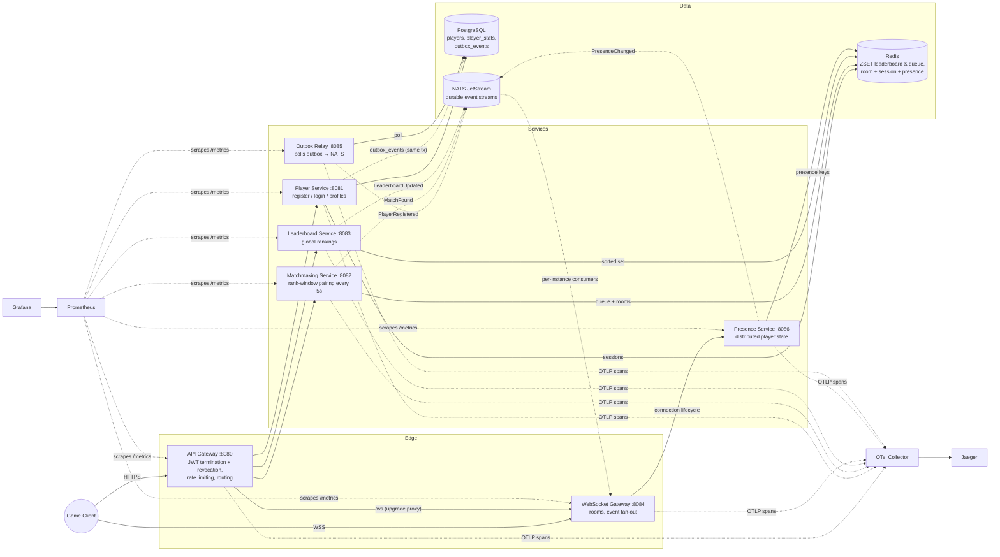
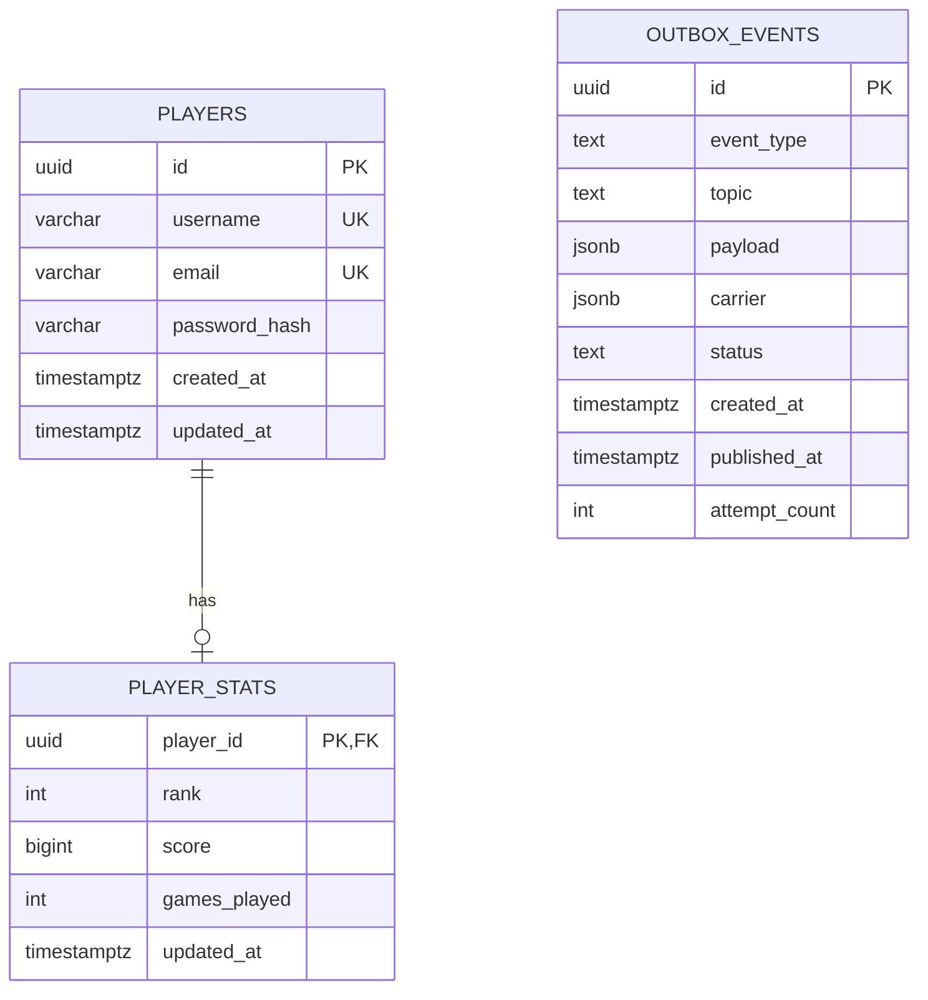
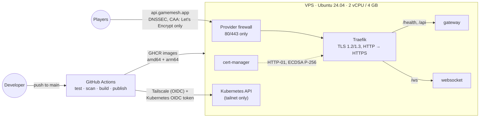
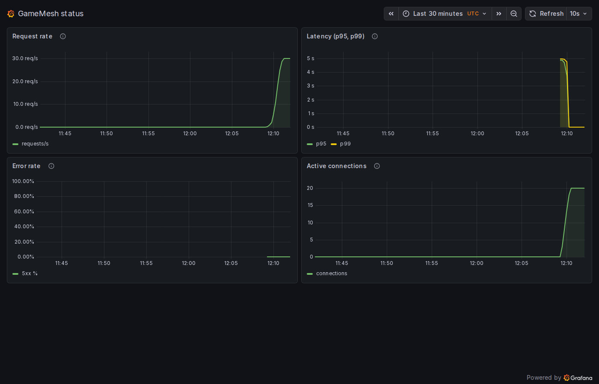

<div align="center">

# GameMesh

**A scalable multiplayer game backend in Go — running in production.**

[](https://github.com/AlpNuhoglu/gamemesh/actions/workflows/ci.yml)
[](https://api.gamemesh.app/health)
[](https://status.gamemesh.app)


Seven Go microservices — player identity, JWT auth with server-side revocation,
rank-based matchmaking, real-time leaderboards, distributed presence and
WebSocket event delivery — over PostgreSQL, Redis and NATS JetStream with a
transactional outbox, instrumented end to end with Prometheus and
OpenTelemetry, and deployed by GitHub Actions to a hardened Kubernetes cluster.

</div>

```console
$ curl https://api.gamemesh.app/health
{"status":"ok","version":"<the commit on main that is deployed>"}
```

Every push to `main` is tested, scanned, built for amd64 and arm64, and
deployed to that endpoint within about seven minutes — with zero failed
requests during the rollout, and an automatic rollback if the new release does
not come up.

---

## Contents

- [Highlights](#highlights)
- [Architecture](#architecture)
- [Production](#production)
- [CI/CD](#cicd)
- [Security](#security)
- [Services](#services)
- [Quick start](#quick-start)
- [Kubernetes locally (k3d)](#kubernetes-locally-k3d)
- [Messaging & the transactional outbox](#messaging--the-transactional-outbox)
- [Presence](#presence)
- [Observability](#observability)
- [Testing & load testing](#testing--load-testing)
- [Configuration](#configuration)
- [Repository layout](#repository-layout)
- [Documentation](#documentation)

## Highlights

| | |
|---|---|
| **Live in production** | Single-node k3s on a VPS, behind Traefik with a Let's Encrypt certificate managed by cert-manager: [`api.gamemesh.app`](https://api.gamemesh.app/health) |
| **Public status page** | [`status.gamemesh.app`](https://status.gamemesh.app): request rate, p95/p99 latency, 5xx rate and open WebSocket connections, live from Prometheus; read-only, no login. Only the page's own paths reach Grafana, and an admission policy keeps it that way |
| **Continuous deployment** | Merge to live in **6 min 46 s** (measured); **3,494 / 3,494** public requests answered 200 during the rollout |
| **Self-healing releases** | A deliberately broken release was merged to test it: the rollout hit its deadline, the previous commit was redeployed with its own manifests, the old pod never restarted |
| **No standing credentials in CI** | GitHub Actions reaches the cluster over Tailscale with short-lived OIDC tokens only — no kubeconfig, no service-account token, no VPN key stored anywhere |
| **Durable, traced events** | NATS JetStream with a transactional outbox; one trace spans HTTP → Postgres → relay → NATS → WebSocket |
| **Supply chain** | Every action pinned by SHA, every image by digest; Trivy, gitleaks and govulncheck gate every merge |

## Architecture



<details>
<summary><b>Data model</b></summary>



</details>

### Key design decisions

| Decision | Rationale |
|---|---|
| **Gateway terminates JWT, forwards `X-User-ID`** | Auth lives in one place; internal services stay simple and are reachable only on the cluster network. The WebSocket service validates tokens itself (browsers can't set headers on an upgrade) and re-checks the session at the handshake and every 10 s, so a logout closes live sockets too. |
| **Session revocation with a short-TTL in-process cache** | Every authenticated request honours logout without a Redis round-trip per request: a 5 s positive cache bounds how long a revoked token stays usable on one replica. |
| **Redis ZSETs for leaderboard and matchmaking queue** | `ZADD`/`ZREVRANK` are O(log n) at millions of members; a rank-scored queue lets each 5 s tick pair neighbours in O(n) with no sort step. |
| **NATS JetStream behind `Publisher`/`Subscriber`** | Durable, replayable, at-least-once delivery with explicit ACK/NAK — a lost `MatchFound` is a correctness bug. Work-queue consumers share a durable; the WebSocket fan-out uses one ephemeral consumer per instance so every replica sees every event. |
| **Transactional outbox for player events** | The business row and its event are written in one Postgres transaction; the relay publishes asynchronously — no dual-write problem. Relay replicas coordinate through `FOR UPDATE SKIP LOCKED`, without a leader. |
| **Presence as its own service with TTL + heartbeat** | A full state machine (`ONLINE`/`IN_QUEUE`/`IN_MATCH`/`AWAY`/`OFFLINE`); a 45 s TTL refreshed every 15 s means a crashed client heals itself with no reaper job. |
| **Trace context inside the event envelope** | W3C trace headers travel in a `Carrier` field, so a trace survives Redis, NATS *and* the outbox's database round-trip. |
| **Fail fast on weak production config** | With `APP_ENV=production` every service refuses to start on a missing, short (< 32 chars) or default secret — a misconfigured release never takes traffic. |

Full discussion: [docs/architecture.md](docs/architecture.md)

## Production



| Layer | What runs |
|---|---|
| **Host** | One netcup VPS (x86), Ubuntu 24.04 with unattended security updates and reboots only when an update needs one; SSH only over Tailscale, keys only, no root login |
| **Network** | Provider-level firewall in front of the VM: only 80/443 (and Tailscale's WireGuard port) reach it. The Kubernetes API, the kubelet and SSH are unreachable from the internet (measured from another network) |
| **Cluster** | k3s v1.35 (single node), Secrets encrypted at rest, flannel `host-gw` (no UDP listener), Traefik keeping the client's real address for per-client rate limiting |
| **TLS** | cert-manager v1.21 with Let's Encrypt (staging proven first), ECDSA P-256 certificate renewed at two thirds of its life; only `/health`, `/api` and `/ws` are routed |
| **Workloads** | The prod Kustomize overlay: 10 pods, all under Pod Security `restricted` (non-root, read-only root filesystem, no capabilities, seccomp), with startup/readiness/liveness probes and graceful shutdown |
| **Rebuild** | The whole server is reproducible from [docs/deployment.md](docs/deployment.md), verified by a rebuild drill on an empty VM |

A reboot is back to serving in about 40 seconds without intervention; a k3s
restart serves every request (3,636 / 3,636).

## CI/CD

```text
pull request ──► lint · unit tests (-race) · integration (Testcontainers) · image build + Trivy
                 · repo scan · gitleaks (full history) · third-party image scan
                 · kubeconform · govulncheck ──► ci-ok (the one required check)

push to main ──► the same ──► publish (GHCR, amd64 + arm64, by commit SHA)
                          ──► deploy (environment: production, one at a time)
```

The **deploy** job, also runnable by hand to roll back to any commit on `main`:

1. joins the tailnet as an ephemeral, ACL-restricted node and obtains GitHub
   OIDC tokens the Kubernetes API accepts only from this repository's `main`
   in the `production` environment;
2. checks all seven images of the commit are published, then applies the prod
   overlay after a server-side dry run;
3. waits for every rollout, then for `https://api.gamemesh.app` to serve the
   commit from the outside;
4. on any failure, redeploys the commit that ran before **with its own
   manifests and images** and fails the job.

## Security

- **Least privilege for CI.** CI's Kubernetes identity may write only what the
  prod overlay holds, in one namespace — no Secrets, exec, delete, RBAC or
  cluster-scoped rights — and a `ValidatingAdmissionPolicy` keeps Services
  `ClusterIP` (no `externalIPs`) and Ingresses on the one public host,
  whoever writes them.
- **No long-lived credentials.** Tailscale workload identity federation and
  Kubernetes structured authentication both trust GitHub's OIDC tokens
  (5-minute lifetime), validated against immutable repository and owner IDs.
- **Pinned supply chain.** Actions by commit SHA, base and third-party images
  by digest, kubectl and kubeconform by checksum; Dependabot proposes updates.
  Accepted scanner findings are scoped to one file or binary and expire.
- **Secrets.** Never in the repository; random 32-byte values created in the
  cluster, encrypted at rest; services refuse weak values in production.
- **Edge.** HSTS-preloaded `.app` domain, DNSSEC, a CAA record allowing only
  Let's Encrypt, DMARC `p=reject`; spoofed `X-Forwarded-For` headers are
  ignored.

## Services

| Service | Port | Responsibility |
|---|---|---|
| `gateway` | 8080 | JWT termination + revocation check, rate limiting, CORS, reverse proxy, WebSocket upgrade passthrough |
| `player` | 8081 | Registration, login/logout, profiles, `player_stats`, outbox writes |
| `matchmaking` | 8082 | Rank-window queue, 5 s pairing tick, room creation, stale-entry eviction |
| `leaderboard` | 8083 | Score submission, global rankings, rank lookup |
| `websocket` | 8084 | Client connections, rooms, event fan-out, session checks, presence feed |
| `outbox-relay` | 8085 | Polls `outbox_events`, publishes to NATS, retries, dead-letters |
| `presence` | 8086 | Presence state machine, heartbeats, friend presence lookup |

Every service exposes `/livez` and `/readyz` (the latter checks its own
dependencies) and `/metrics`; the gateway's `/health` reports the deployed
commit.

## Quick start

One command brings up the whole stack — services, datastores and the
observability tools:

```bash
cp .env.example .env      # optional; everything has dev defaults
docker compose up --build
```

| URL | What |
|---|---|
| http://localhost:8080 | API Gateway |
| ws://localhost:8084/ws?token=… | WebSocket Gateway |
| http://localhost:16686 | Jaeger — distributed traces |
| http://localhost:9090 | Prometheus |
| http://localhost:3000 | Grafana — "GameMesh Overview" dashboard pre-provisioned |
| http://localhost:8222 | NATS monitoring |

Ports are bound to `127.0.0.1` only.

<details>
<summary><b>Smoke test</b></summary>

```bash
# Register + login
curl -s localhost:8080/api/v1/auth/register -d '{"username":"neo","email":"neo@example.com","password":"password123"}'
TOKEN=$(curl -s localhost:8080/api/v1/auth/login -d '{"identifier":"neo","password":"password123"}' | jq -r .token)

# Submit a score, read the leaderboard
curl -s localhost:8080/api/v1/score -H "Authorization: Bearer $TOKEN" -d '{"score":150,"increment":true}'
curl -s localhost:8080/api/v1/leaderboard/top/10

# Queue for a match (two players within the rank window are paired within 5 s)
curl -s localhost:8080/api/v1/queue -H "Authorization: Bearer $TOKEN" -d '{"rank":1000}'

# Live events
npx wscat -c "ws://localhost:8084/ws?token=$TOKEN"

# Then open Jaeger (:16686), pick the "gateway" service and follow the request
# end to end, including the asynchronous NATS hop.
```

</details>

<details>
<summary><b>Without Docker</b></summary>

```bash
# Needs local PostgreSQL + Redis + NATS (or: docker compose up postgres redis nats)
go run ./cmd/player & go run ./cmd/leaderboard & go run ./cmd/matchmaking &
go run ./cmd/presence & go run ./cmd/outbox-relay & go run ./cmd/websocket &
go run ./cmd/gateway
```

Set `OTEL_ENABLED=false` when running without a collector: the code paths stay
identical, spans just become non-recording.

</details>

## Kubernetes locally (k3d)

The same distribution as production, on your machine:

```bash
k3d cluster create gamemesh --image rancher/k3s:v1.35.5-k3s1 \
  --api-port 127.0.0.1:6550 -p "127.0.0.1:18080:80@loadbalancer" --agents 0 --wait

make k8s-build     # builds gamemesh/<service>:dev and loads it into k3d
make k8s-apply     # kubectl apply -k deployments/k8s/overlays/local (refuses any other context)

kubectl -n gamemesh get pods
curl -H 'Host: gamemesh.localhost' http://127.0.0.1:18080/health
```

The manifests are a Kustomize tree: `base/` for what every environment shares,
`overlays/local` (local images, generated dev secrets) and
`overlays/prod` (published images, one replica each, TLS); `monitoring/`
(Prometheus and Grafana, their own namespace, in production too). Guide:
[docs/deployment.md](docs/deployment.md)

## Messaging & the transactional outbox

Inter-service events flow over **NATS JetStream** (durable, at-least-once,
replayable) behind the `events.Publisher` / `events.Subscriber` interfaces;
`EVENT_BUS=redis` switches to Redis Pub/Sub without touching a service.

Player identity events use the **transactional outbox**: the player service
inserts into `outbox_events` in the same transaction as the business write, and
`outbox-relay` polls, publishes and marks rows published; failed publishes are
retried and eventually dead-lettered.

| Topic | Events |
|---|---|
| `events.player` | `PlayerRegistered`, `PlayerUpdated`, `SessionRevoked` (via outbox) |
| `events.matchmaking` | `MatchFound` |
| `events.leaderboard` | `LeaderboardUpdated` |
| `events.presence` | `PresenceOnline`, `PresenceOffline`, `PresenceStateChanged` |

Details: [docs/messaging.md](docs/messaging.md) · [docs/outbox.md](docs/outbox.md)

## Presence

```
OFFLINE → ONLINE → IN_QUEUE → IN_MATCH → ONLINE → …  (AWAY from any state)
```

Presence keys carry a 45 s TTL refreshed by 15 s heartbeats, so a missing key
**is** offline. The WebSocket gateway feeds connection lifecycle over HTTP and
batches the heartbeats of all its connections into one bulk call. Only
`OFFLINE → IN_QUEUE` and `OFFLINE → IN_MATCH` are rejected, so future
reconnect, party and rematch flows never need the state machine edited.

Details: [docs/presence.md](docs/presence.md)

## Observability

- **Metrics** — a Prometheus registry per service: per-route request/error/
  latency histograms plus domain metrics (active WebSocket connections, queue
  depth, matches created, events published/consumed/failed, presence
  transitions, outbox depth and dead-letters).
- **Tracing** — OpenTelemetry in all seven services over OTLP to a Collector
  and Jaeger; Gin, the gateway's proxy, Redis and GORM are instrumented (query
  values excluded), with manual spans on the business paths. High-volume event
  types are sampled down to 1 % while trace context keeps propagating.
- **Logs** — structured zap with `request_id`, `user_id`, `client_ip` and
  `trace_id`/`span_id` on every request, so a log line jumps to its trace.

In production, Prometheus and Grafana run in their own namespace, never
exposed; tracing (the Collector and Jaeger) runs in compose and locally only.
Four of Grafana's panels are public at
[status.gamemesh.app](https://status.gamemesh.app), here under a k6 load from
outside (30 requests/s and 20 WebSocket connections; the latency spike at the
start is k6's 40 bcrypt-bound register and login calls, the load's own p95 is
2.5 ms server-side):



Details: [docs/observability.md](docs/observability.md)

## Testing & load testing

```bash
make test               # unit tests, -race, coverage
make test-integration   # Testcontainers: real PostgreSQL + Redis (needs Docker)
make lint               # golangci-lint
make k6-matchmaking     # ramp to 5,000 concurrent matchmaking players
make k6-leaderboard     # 10,000 leaderboard updates
make k6-websocket       # 1,000 concurrent WebSocket clients
```

Measured at 500 virtual users for 1 minute on a single laptop that also runs
the load generator, all seven services and every datastore (`POOL=500 k6 run
--vus 500 --duration 1m`, docker-compose, rate limit raised as below;
2026-10-25) — a realistic arrival pattern, not a throughput benchmark. The p95
is the load's own (`http_req_duration{phase:load}`): setup's register and login
calls are bcrypt-bound, about 200 ms each, and counting them put matchmaking's
p95 anywhere between 86 and 190 ms from run to run (the "112 ms" this table
used to show):

| Scenario | Iterations | Req/s | p95 | Errors |
|---|---|---|---|---|
| matchmaking | 6,500 | 194 | 27–31 ms *(two runs)* | 0.00–0.13 % |
| leaderboard | 332,138 | 2,838 | 18 ms | 0.01 % |
| websocket | 989 sessions (avg 43 s) | — | 129 ms *(connect)* | 0.00 % |

The few errors are connections reset between k6 and Docker Desktop's port
forwarding, before the gateway. Before the gateway reused its upstream
connections (finding #96), the leaderboard run at 770 requests/s answered
12.7 % with 502: the gateway had run out of local ports.

<details>
<summary><b>Before citing numbers</b></summary>

- **The gateway rate-limits per client IP** (`RATE_LIMIT_RPS`, default 50). k6
  sends from one address, so above ~50 rps an unmodified run measures the
  limiter (80 % HTTP 429 at 500 VUs). Raise it for the load-test run only:
  `RATE_LIMIT_RPS=20000 RATE_LIMIT_BURST=40000 docker compose up -d --no-deps gateway`.
- **`POOL` must be ≥ the VU count:** each script provisions real accounts, and
  two VUs sharing a token are the same queue member.
- **500 VUs is the honest level on this hardware.** At 1,000 VUs a Jaeger trace
  shows the server spending 21 ms at p95 while k6 observes 204 ms; the slowest
  traces spend 99 % of their wall clock queueing on a saturated host, against
  267 µs of Redis work. The figures are a lower bound for dedicated hosts.

Full write-up: [docs/postmortem-throughput-ceiling.md](docs/postmortem-throughput-ceiling.md)

</details>

## Configuration

Everything is environment-driven with working development defaults — see
[.env.example](.env.example). The knobs worth knowing:

| Variable | Default | What |
|---|---|---|
| `APP_ENV` | `development` | `production` refuses missing, short or default secrets |
| `EVENT_BUS` | `nats` | `nats` (JetStream) or `redis` (Pub/Sub) |
| `MATCH_INTERVAL_SECONDS` / `MATCH_RANK_WINDOW` | `5` / `100` | Pairing tick and rank tolerance |
| `PRESENCE_TTL` / `PRESENCE_HEARTBEAT_INTERVAL` | `45s` / `15s` | Presence expiry and refresh cadence |
| `SESSION_CACHE_TTL` | `5s` | Revocation-check cache; the worst-case revocation lag |
| `RATE_LIMIT_RPS` / `RATE_LIMIT_BURST` | `50` / `100` | Per-client rate limit at the gateway |
| `TRUSTED_PROXIES` | — | Proxies whose `X-Forwarded-For` the gateway believes (Traefik's pod network in Kubernetes) |
| `OTEL_ENABLED` | `true` | Tracing on or off; the code path is the same |

## Repository layout

```
cmd/            entrypoints of the seven services
internal/       service logic (handlers → services → repositories)
pkg/            shared libraries: auth, config, database, events, health,
                httpx, logger, metrics, middleware, server, tracing
deployments/
  docker/       the one multi-service Dockerfile
  k8s/          Kustomize: base, overlays/{local,prod},
                monitoring, namespaces, cluster-level manifests (cert-manager,
                issuers, RBAC, admission policies, Traefik)
  server/       the VPS: sshd and update policies, k3s config, OIDC auth,
                Tailscale policy
.github/        CI, deploy and cluster-access workflows; reusable actions
migrations/     versioned SQL migrations
scripts/        database schema and seed, k6 load tests, k8s helpers
tests/          Testcontainers integration tests
docs/           architecture, API, operations
```

## Documentation

- [Architecture & design decisions](docs/architecture.md) · [Design document](docs/design-document.md)
- [API reference](docs/api.md)
- [Messaging](docs/messaging.md) · [Transactional outbox](docs/outbox.md) · [Presence](docs/presence.md)
- [Observability](docs/observability.md)
- [**Deployment & production runbook**](docs/deployment.md) — rebuild, deploy, roll back, rotate secrets, troubleshoot
- [Troubleshooting](docs/troubleshooting.md)
- [Throughput post-mortem](docs/postmortem-throughput-ceiling.md)
- [Deployment phase 1 plan & findings](docs/deployment-phase1-plan.md) *(Turkish)* — every step from a laptop to production, with measurements

## License

MIT
